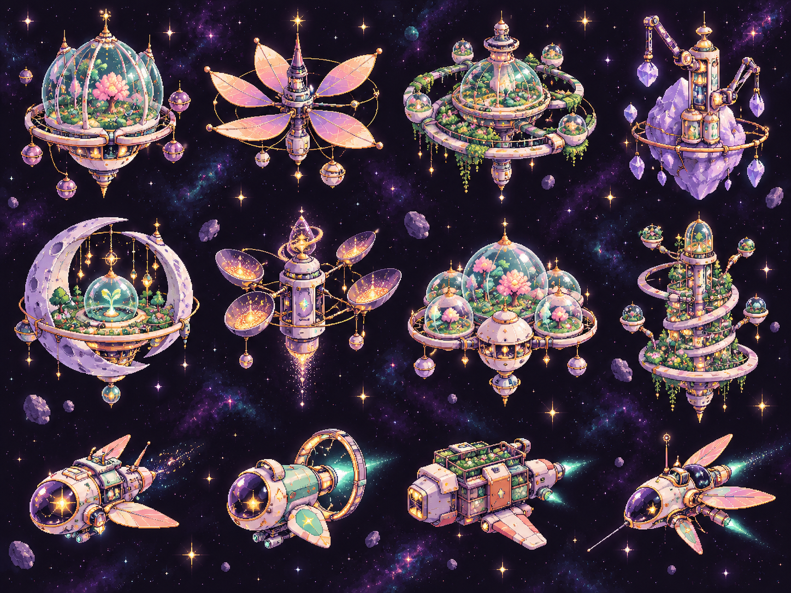
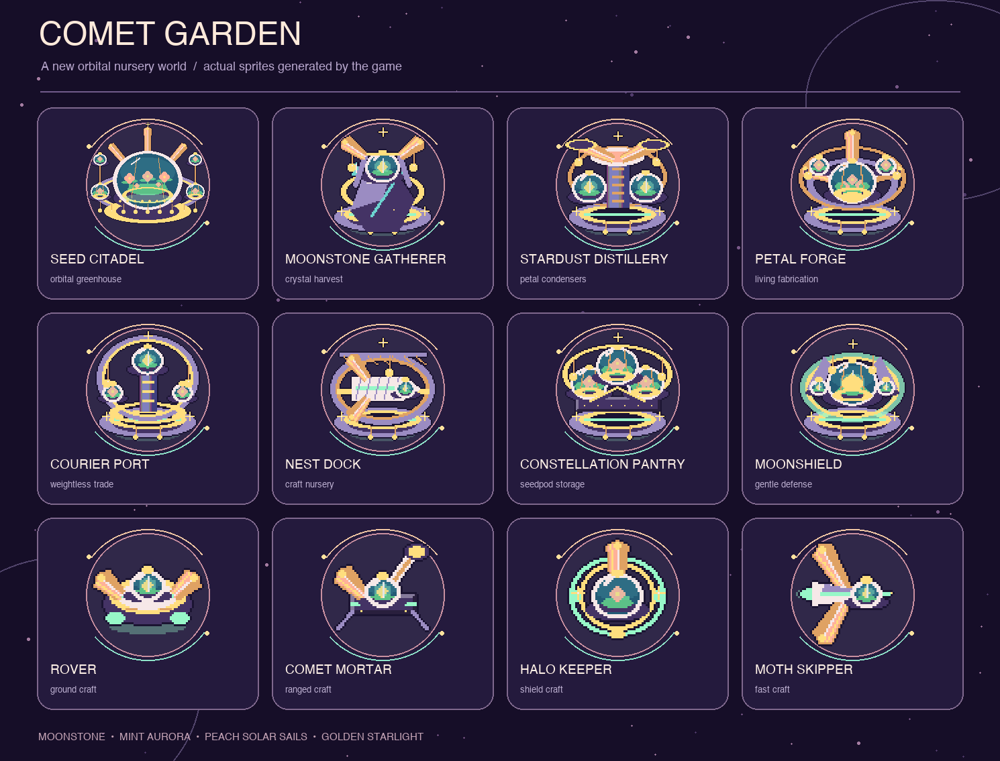

# Comet Garden

An original space-colony graphics direction: floating nurseries cultivate luminous plants in glass seedpods, while petal sails and orbital trellises collect starlight. Moonstone lavender, mint aurora, peach and warm gold carry through the world sprites, starfield and UI.

## Concept

## Game sprites

The game sprites are generated by `CometGardenArt` at runtime. They replace the station, craft and asteroid visuals on this branch; game rules are unchanged. Player territory uses mint, AI territory uses peach, and neutral territory uses lavender.

The runtime sprites have layered glass domes with planted interiors, gold ribs and hanging lights, petal sail veins, and more detailed craft hulls to carry the concept's materials into the playable map.

To refresh the game-sprite sheet, use **Tools → Orbital Foundry → Export Comet Garden Sprites** in Unity, then run `python3 tools/make_comet_garden_preview.py` with Pillow installed.

For a local play test, build with **Tools → Orbital Foundry → Build Web**, then run `python3 tools/serve_web.py 8080` and open `http://127.0.0.1:8080/`. The test build on 13 October 2026 loaded in the browser; a new game, extractor and refinery placement worked without browser errors.
